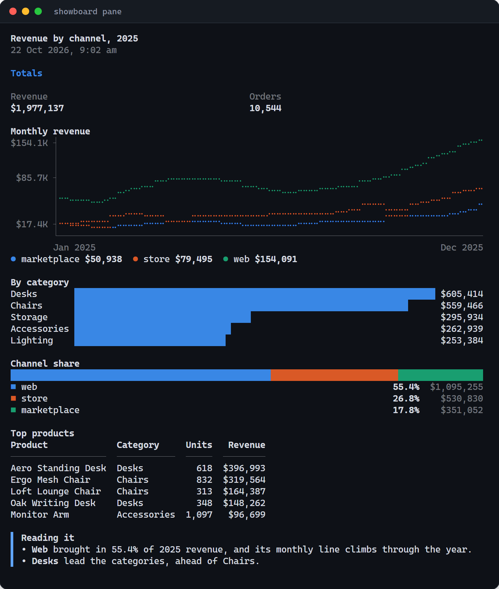

<div align="center">


### Ask in your terminal. Get a dashboard on your screen.

Showboard is an open-source **MCP server** that lets **Claude Code**, Codex, Cursor, Gemini CLI and other coding agents answer questions about your **SQL database**, or a folder of **Excel and CSV files**, with charts, tables and headline numbers: in your browser, inside your own app, or beside your terminal.

[](#works-with-your-agent)
[](LICENSE)
[](#quick-start)
[](#contributing)

**[Quick start](#quick-start)** &nbsp;·&nbsp; **[How it works](#how-it-works)** &nbsp;·&nbsp; **[Benchmark](#benchmark)** &nbsp;·&nbsp; **[Docs](docs/reference.md)**

</div>

<br />


<p align="center">
  <b>2.7× cheaper</b> &nbsp;·&nbsp; <b>3.5× fewer output tokens</b> &nbsp;·&nbsp; <b>3.2× faster</b>
  <br />
  <sub>Claude Code with Showboard against Claude Code on its own, on the same questions and the same files. <a href="#benchmark">See the benchmark</a></sub>
</p>

> [!NOTE]
> **Built with AI assistance.** Showboard is developed with help from AI coding agents, mostly Claude Code. A test suite and a [measured benchmark](bench/README.md) keep it honest. It is young, so issues and pull requests are welcome.

## Why Showboard

Ask a coding agent for a chart of your data and watch what it does. It writes Python to read your files and work out the numbers, checks the results over several steps, then writes an HTML page, chart code and all. It gets there, but every answer is a small software project, paid for in tokens and minutes, and the numbers live in code you have to read to trust.

Showboard gives the agent a shorter path. The agent writes a few SQL queries and a short layout. Showboard runs the queries read-only, picks a chart for each result, lays out the board and puts it on your screen.

| | Claude Code on its own | Claude Code + Showboard |
| --- | --- | --- |
| **You get** | Paragraphs, or an HTML file it wrote | A board of charts, tables, headline numbers and notes |
| **You see it** | In the terminal, or in a file you open | In your browser, inside your app, or beside your terminal |
| **The numbers come from** | Python it wrote and ran | Read-only SQL, one click away under every chart |
| **24 answers, measured** | $4.77 and 24.3 minutes | **$1.78 and 7.5 minutes** |

## Benchmark

<p align="center">
  <picture>
    <source media="(prefers-color-scheme: dark)" srcset="docs/images/benchmark-dark.png" />
    
  </picture>
</p>

Five questions about the sample spreadsheets (one with a follow-up), each asked four times over two runs: 24 answers each way, in Claude Code with Opus 5.5 at medium effort. On its own, Claude worked the numbers out in Python, then wrote an HTML page of charts. With Showboard, it wrote SQL and a short layout.

- **2.7× cheaper:** $1.78 against $4.77, at API list price. On Pro and Max plans the same tokens count against your usage limit instead.
- **3.5× fewer output tokens:** 36,659 against 128,929, and 2.3× fewer new input tokens (99,200 against 231,443).
- **3.2× faster:** 7.5 minutes against 24.3.
- **Cheaper on all 24 answers,** by 1.6× to 4.4×, with the same figures both ways.

Most of what an answer costs is steps, because each step re-reads the whole conversation. On its own, Claude writes the analysis as code, checks it over several turns, then writes the page. With Showboard, a board is one call, and a board worth repeating becomes a recipe. In the [demo shop](#try-the-demo), at API list prices, *"Top 5 products of 2025"* was one `recipe` call ($0.26), and *"Each channel's revenue by quarter, 2025 vs 2026"* one `draw` call ($0.37) that saved itself as a recipe.

To be fair to the other side: the pages Claude wrote on its own were more designed, each made to measure, where Showboard's boards are plainer and consistent. This is two runs on one dataset, and other agents have not been measured yet. The questions, every turn's results and how to rerun it on your own files are in [bench/](bench/README.md).

## Quick start

> [!IMPORTANT]
> Showboard is not on npm yet. Run it from a clone of this repository, and wherever this page says `npx showboard`, use `node <your clone>/packages/showboard/dist/cli/main.js` instead. `init` run that way writes settings that start Showboard from your clone.

You need Node.js 22.13 or later and a coding agent. The demo uses Claude Code.

### Try the demo

A small furniture shop's admin app, with its orders in SQLite:

```bash
git clone https://github.com/rohanbeingsocial/showboard.git
cd showboard
npm install
npm run demo        # builds, seeds the shop's database and serves http://localhost:4710
```

Open http://localhost:4710, then start Claude Code in the demo's folder from a second terminal:

```bash
cd examples/sales-demo
claude              # the .mcp.json here connects Claude Code to the demo
```

Approve the folder's `showboard` server when Claude Code asks, then try:

- *"Show me my best seller of 2026, and how it compares with last year."*
- *"Top 5 products of 2025."* This one is a recipe the demo ships, so the board takes a single tool call.
- *"Open the Aero Standing Desk's orders from October."* Claude runs the shop's own Orders filter.

### Your spreadsheets

```bash
cd my-reports          # a folder of .xlsx, .xlsm, .csv or .tsv files
npx showboard init .   # Claude Code; --agent codex,cursor,gemini… for others
claude                 # then open http://localhost:4710, or run: npx showboard pane
```

Each sheet becomes a table the agent can query and join. Loading copes with the usual mess: title rows above the header, blank rows, "Total" rows (skipped, so sums do not double count), `N/A` in number columns, `₹1,23,456` and `$1,234.50` typed as text, Excel dates, and `15-Mar-2026` or `25/04/2026` text dates. Amounts print in the files' own currency, ₹ in lakh and crore for rupee sheets. Your files are only read, and they reload when you save them. To try it on sample files: `cd examples/spreadsheets`, run `claude` and open http://localhost:4720.

### A database, no app

```bash
npx showboard init --db ./shop.sqlite   # a SQLite file or a Postgres URL
claude                                  # boards appear at http://localhost:4710
```

A Postgres URL with a password is better kept out of the settings files: leave `--db` out, and set `SHOWBOARD_DB` in your environment before you start your agent.

### Your own app

Mount Showboard in your Node server and React pages: see [Put boards in your own app](#put-boards-in-your-own-app).

## How it works

1. **You ask** your agent a question, like *"Which regions are behind their 2026 targets?"*
2. **The agent calls Showboard** over MCP: a saved recipe if one fits, or `draw` with one SQL query per chart.
3. **Showboard draws the board.** It runs each query read-only, picks a chart from the shape of each result and lays out the board.
4. **The board appears** on your screen and joins the saved boards. The agent gets the rows back, so it can check what it tells you.

The agent never types a figure into a chart: every number comes from a query, and every chart can show its SQL. Think of Showboard as a pen for your agent, with two limits on purpose: in your app it draws only where you give it room, and it acts only through the actions you register, never by clicking around your screen.

## Excel and CSV, no app needed


A folder of spreadsheets is all it needs. Here Claude Code compares 2026 orders in an Excel workbook with targets in a CSV file, amounts in rupees, and *Show sources* opens the SQL behind a chart.

## Inside your own app


Mount Showboard in your React app and the agent can also see what is on screen and run the actions you register. Here Claude reads the demo shop's screen with `get_screen`, then runs the shop's own `filter_orders` action, and the app opens its Orders page, filtered.

## Beside your terminal

<p align="center">
  
</p>

No browser needed: `showboard pane` draws each board as text in a terminal split beside your agent, and follows each new board as the agent draws it.

```bash
npx showboard pane                                         # Showboard on port 4710
npx showboard pane --url http://localhost:3000/showboard   # one your app mounts
```

Lines become braille, bars become blocks, shares become one stacked bar with a legend, and tables, notes and headline numbers print as they are, every figure read from the board's data. Keys: <kbd>←</kbd> <kbd>→</kbd> older and newer boards, <kbd>s</kbd> sources, <kbd>1</kbd>–<kbd>9</kbd> the board's buttons (they run in your app), <kbd>o</kbd> the browser, <kbd>q</kbd> quit. `--once` prints the board and exits.

In Claude Code, the same view sits beside the chat as a mod: [plugins/claude-code](plugins/claude-code). It opens by itself when a board arrives and the terminal has room, and `/board` opens it anywhere. Install it at the prompt of a Claude Code terminal session:

```text
/plugin install showboard --marketplace rohanbeingsocial/showboard
```

## Features

- **Read-only by design.** Postgres queries run in a `READ ONLY` transaction with a time and row limit; SQLite files and spreadsheets are opened read-only.
- **Charts picked from the data.** Dates become lines, labels become bars, a single row becomes headline numbers, anything else a table. The agent can still choose every chart itself.
- **One call per board.** `draw` fetches and lays out a whole board, with notes, side-by-side rows and titled sections, in a single tool call.
- **Recipes.** A board worth repeating becomes a one-call recipe with parameters. Your app ships its own, and the agent saves new ones.
- **Show sources.** Every chart, table and number can show the query behind it.
- **Messy spreadsheets welcome.** Title rows, "Total" rows, `N/A`, amounts typed as text and text dates are all handled.
- **Your app, your components.** Boards can use your own React components and run your app's actions, and the agent can see what is on screen.
- **Any MCP agent.** `showboard init --agent` writes the settings for Claude Code, Codex, OpenCode, Gemini CLI, Cursor, VS Code, Antigravity and Windsurf.
- **A pane beside the terminal.** `showboard pane` for any agent, and a mod beside the chat in Claude Code.
- **A cheaper model for new boards.** In Claude Code, a `board-builder` agent on Sonnet builds new kinds of board in its own small context.
- **No extra API key.** It runs on the agent you already use.

## Works with your agent

Showboard is an MCP server, so any coding agent that speaks MCP can use it. `showboard init --agent <names>` writes the settings for each one you name (comma separated, or `all`); with no `--agent`, it sets up Claude Code plus any agent the folder already has settings for.

| Agent | `init` writes | Notes |
| --- | --- | --- |
| Claude Code | `.mcp.json` | Approve the server when Claude Code first asks. Also gets the `board-builder` agent. |
| Codex | `.codex/config.toml` | Codex reads it only in a trusted project. |
| OpenCode | `opencode.json` | `opencode mcp list` shows it connected. |
| Gemini CLI | `.gemini/settings.json` | Trust the folder when Gemini CLI asks; `gemini mcp list` shows it connected. |
| Cursor | `.cursor/mcp.json` | Names the project folder with `--root`, since Cursor starts servers elsewhere. |
| VS Code | `.vscode/mcp.json` | Uses `${workspaceFolder}`; start it under MCP Servers, then use agent mode. |
| Antigravity | `~/.gemini/config/mcp_config.json` | User-wide, so the entry names the project folder. Named only on purpose: not part of `all`. |
| Windsurf | `~/.codeium/windsurf/mcp_config.json` | User-wide, like Antigravity. |

Boards have been drawn end to end in Claude Code. For the other agents, the settings `init` writes have been checked to load and connect, and the server answers their MCP requests; a live session in each is still to come.

## Put boards in your own app

```bash
npm install showboard zod
npm install pg          # only for Postgres
```

The React parts need React 19. Before Showboard is on npm, run `npm pack` in `packages/showboard` of a built clone, then `npm install <path>/showboard-0.2.0.tgz zod` in your app.

**Server.** The handler takes a fetch `Request` and returns a `Response`, so any Node server can mount it.

```ts
import { createShowboard } from "showboard/server";

const showboard = await createShowboard({
  db: process.env.DATABASE_URL,      // a Postgres URL, a SQLite file, or { pool } with your own pg Pool
  boardsDir: ".showboard/boards",    // keep boards across restarts
});
const handle = showboard.handler({ basePath: "/showboard" });

app.all("/showboard/*", (c) => handle(c.req.raw));            // Hono
// node:http and Express: toNodeListener(handle) from "showboard/server"
```

**Browser.**

```tsx
import { Board, BoardList, ShowboardProvider } from "showboard/react";
import "showboard/styles.css";

<ShowboardProvider url="/showboard" onBoard={() => navigate("/board")}>
  <App />
</ShowboardProvider>;

// On the page that holds the agent's answers:
<Board />        {/* the board shown last */}
<BoardList />    {/* saved boards; click one to open it */}
```

**Your agent.** In your project folder, then start your app and your agent:

```bash
npx showboard init --url http://localhost:3000/showboard --agent claude,codex
```

Your agent's own login covers your own and internal dashboards; putting Showboard in front of your customers needs a model API key instead.

<details>
<summary><b>More examples:</b> a whole board in one call, recipes, your own components, actions and state, rows your server computes</summary>

<br />

**A whole board in one call.** What the agent sends to `draw`. Each part brings its own SQL; the first part becomes a line per channel, the second asks for a pie:

```json
{
  "title": "Orders by channel, {year}",
  "params": { "year": "2026" },
  "items": [
    { "note": "Paid orders only.", "tone": "info" },
    { "row": [
      { "title": "By month",
        "sql": "SELECT substr(ordered_at, 1, 7) AS month, channel, count(*) AS orders FROM orders WHERE status = 'paid' AND substr(ordered_at, 1, 4) = :year GROUP BY 1, 2" },
      { "title": "Share", "show": "pie",
        "sql": "SELECT channel, count(*) AS orders FROM orders WHERE status = 'paid' AND substr(ordered_at, 1, 4) = :year GROUP BY 1" }
    ] }
  ],
  "save_as": { "name": "channel_orders", "about": "Paid orders by channel for one year." }
}
```

**The same board for another year** is now one `recipe` call of a few hundred tokens:

```json
{ "name": "channel_orders", "params": { "year": "2025" } }
```

**Recipes your app ships.** `:year` and `:limit` become real query parameters, never text pasted into the SQL:

```ts
createShowboard({
  db,
  recipes: [{
    name: "top_products",
    about: "A year's best-selling products by paid revenue.",
    title: "Top products of {year}",
    params: { year: { default: "2026" }, limit: { default: 10 } },
    items: [{
      title: "Revenue by product",
      sql: `SELECT p.name AS product, round(sum(i.qty * i.unit_price), 2) AS revenue
            FROM order_items i JOIN orders o ON o.id = i.order_id JOIN products p ON p.id = i.product_id
            WHERE o.status = 'paid' AND substr(o.ordered_at, 1, 4) = :year
            GROUP BY p.name ORDER BY revenue DESC LIMIT :limit`,
      formats: { revenue: "currency" },
    }],
  }],
});
```

**Your own components** next to the built-in ones:

```tsx
import { z } from "zod";
import type { ShowboardComponent } from "showboard/react";

const props = z.object({ sku: z.string().describe("Product SKU, e.g. DSK-AERO") });

export const ProductCard: ShowboardComponent<typeof props> = {
  description: "The shop's product card: name, price and units sold this year.",
  props,
  render: ({ props }) => <ProductTile sku={props.sku} />,   // a component you already have
};

const COMPONENTS = { ProductCard };   // a module constant: a new object redraws every board
<ShowboardProvider url="/showboard" components={COMPONENTS}>…</ShowboardProvider>;
```

**Actions the agent can run, and state it can see:**

```tsx
import { useShowboardAction, useShowboardState } from "showboard/react";

const filterOrdersInput = z.object({ month: z.string().describe("YYYY-MM") });   // outside the component

function ClaudeHooks({ page, setPage, setFilters }) {
  useShowboardState("page", page);   // the agent reads it with get_screen
  useShowboardAction({
    name: "filter_orders",
    description: "Open the Orders page for one month.",
    input: filterOrdersInput,
    run: ({ month }) => {
      setFilters({ month });
      setPage("orders");
    },
  });
  return null;
}
```

The agent runs an action with `ui_act`, and a board can carry an `ActionButton` that runs one.

**Rows your server computes**, offered to the agent by name:

```ts
createShowboard({
  db,
  sources: [{
    name: "stock_levels",
    description: "Units in stock per product, from the warehouse system.",
    input: z.object({ category: z.string().optional() }),
    run: ({ category }) => warehouse.stockLevels(category),   // an array of plain objects
  }],
});
```

</details>

## Tools your agent gets

| Tool | What it does |
| --- | --- |
| `describe_data` | Lists the tables and columns, the app's sources and the recipes |
| `recipe` | Draws a ready-made board for new values, in one call |
| `draw` | Fetches and draws a whole board in one call |
| `query_data` | Runs one read-only SELECT and keeps the rows as a named dataset (with a database) |
| `use_source` | Gets rows your server computes (when your app has sources) |
| `show_board` | The long form: a [json-render](https://github.com/vercel-labs/json-render) layout the agent writes element by element; also reopens a saved board |
| `list_boards` | Lists the saved boards |
| `get_screen` | What the browser shows: the page's state, its actions and its components |
| `ui_act` | Runs one of the page's actions |

Showboard tells the agent to reach for a recipe first, then `draw`. New recipes reach the agent without a restart where it listens for tool-list changes, as Claude Code does; `describe_data` lists them for the rest.

## API

| Export | Kind | Purpose |
| --- | --- | --- |
| `createShowboard` | fn | Opens your database or files; returns the tools and the HTTP handler. |
| `toNodeListener`, `serve` | fn | Mount the handler on `node:http` or Express, or serve it on its own. |
| `ShowboardProvider` *(/react)* | component | Connects the page to the handler and holds the board on screen. |
| `Board`, `BoardList` *(/react)* | component | The board shown last, and the saved boards. |
| `useShowboardAction`, `useShowboardState` *(/react)* | hook | Actions the agent can run, and state it can see. |
| `formatValue` *(/react)* | fn | Prints numbers the way boards do, for your own components. |
| `boardToText` *(/text)* | fn | A board as lines of styled text, for a pane of your own. |
| `showboard serve \| mcp \| init \| pane` | CLI | Showboard's own board page, the MCP server, setup for each agent, and the terminal pane. |

The full reference, with every option, prop, tool, flag and the chart-picking rules, is in [docs/reference.md](docs/reference.md).

## Safety

Your agent can read your data. It cannot change it, and in your app it can do only what you let it.

- **Postgres:** each query runs in a `READ ONLY` transaction as a single statement, with a time limit (5 s) and a row limit (5,000).
- **SQLite:** the file is opened read-only, with the same row limit.
- **Spreadsheets:** loaded into an in-memory copy that refuses writes. Your files are only read.
- **SQL:** only `SELECT` (and `WITH … SELECT`, `VALUES`, `TABLE`) is accepted.
- **Actions:** the agent can run only the actions your app registers with `useShowboardAction`, each with an input your schema checks; it cannot click or type anywhere else.
- **HTTP:** the handler answers only `localhost` and `127.0.0.1`, and refuses requests from other sites' pages, so a website open in your browser cannot run the tools.

Use a read-only database role anyway.

## Limits

- **Notes are the agent's own words.** Charts, tables and headline numbers read their values from query results. A note is text the agent writes: it is told to quote only figures it has read, but its conclusions can still be wrong. In testing, Claude once named the wrong product as the units leader, because it had only queried the top 10 by revenue. Tick *Show sources* to check.
- **The pane draws charts as text.** Its braille lines and block bars carry the same figures, at a terminal's resolution; the board page has the full charts.
- **A board is a snapshot.** It keeps the rows it was drawn from, so opening it next week shows the numbers as they were then. Ask again, or run its recipe, for fresh ones.
- **Big results are cut.** A query keeps at most 5,000 rows, and a chart draws at most 6 lines, or 4 bars per label. The agent is told what was left out, so it can aggregate or filter in SQL.

## FAQ

<details>
<summary><b>Does my data leave my computer?</b></summary>

<br />

Showboard itself runs on your computer, answers only `localhost`, and sends nothing anywhere. The rows a query returns go to your agent, and so to the agent's model, like anything else your agent reads.

</details>

<details>
<summary><b>Do I need an API key?</b></summary>

<br />

No. Showboard runs on the coding agent you already use, with the login it already has. Putting Showboard in front of your customers is different: that needs a model API key.

</details>

<details>
<summary><b>Can the agent change my data, or click around my app?</b></summary>

<br />

No. Every query is read-only, and in your app the agent can run only the actions you register, with inputs your schema checks. See [Safety](#safety).

</details>

<details>
<summary><b>Does it work with agents other than Claude Code?</b></summary>

<br />

Yes, with any agent that speaks MCP. `showboard init --agent` writes the settings for Codex, OpenCode, Gemini CLI, Cursor, VS Code, Antigravity and Windsurf. Claude Code is the one tested end to end so far; see [Works with your agent](#works-with-your-agent).

</details>

## Roadmap

- [x] A pane beside the terminal: `showboard pane` for any agent, and a Claude Code mod
- [x] Settings for Codex, OpenCode, Gemini CLI, Cursor, VS Code, Antigravity and Windsurf
- [ ] Publish to npm
- [ ] A leaner launch that trims Claude Code's fixed prompt, the biggest share of what a board costs
- [ ] A `board-builder` agent for the agents besides Claude Code that have subagents

## Contributing

Contributions are welcome, AI-assisted ones included. Read your diff before you send it, and make sure the tests pass. For anything bigger than a fix, open an issue first. [CONTRIBUTING.md](CONTRIBUTING.md) has the details.

```bash
npm install
npm run build        # the package, its board page and the Claude Code mod's renderer
npm test             # SHOWBOARD_TEST_PG=<postgres url> also runs the Postgres tests
npm run test:pane    # the Claude Code mod, in Claude Code's own plugin test kit
npm run typecheck
npm run demo
```

| Folder | What is in it |
| --- | --- |
| `packages/showboard/src/server` | `createShowboard`, the tools, read-only database access, spreadsheet loading, the HTTP handler |
| `packages/showboard/src/react` | `ShowboardProvider`, `Board`, the built-in components and the hooks |
| `packages/showboard/src/spec` | The component catalog, number formats and board checks |
| `packages/showboard/src/text` | Boards drawn as text, for the panes |
| `packages/showboard/src/cli` | The `serve`, `mcp`, `init` and `pane` commands, and each agent's settings |
| `packages/showboard/src/viewer` | Showboard's own board page |
| `plugins/claude-code` | The Claude Code mod: the pane beside the chat, listed for `/plugin install` in `.claude-plugin/marketplace.json` |
| `examples/` | The demo shop and the sample spreadsheets |
| `bench/` | The cost benchmark |

## License

MIT. See [LICENSE](LICENSE).

## Star history

<div align="center">

<a href="https://www.star-history.com/#rohanbeingsocial/showboard&Date">
  <picture>
    <source media="(prefers-color-scheme: dark)" srcset="https://api.star-history.com/svg?repos=rohanbeingsocial/showboard&type=Date&theme=dark" />
    <source media="(prefers-color-scheme: light)" srcset="https://api.star-history.com/svg?repos=rohanbeingsocial/showboard&type=Date" />
    
  </picture>
</a>

If Showboard saved you some tokens, a ⭐ helps other people find it.

</div>
