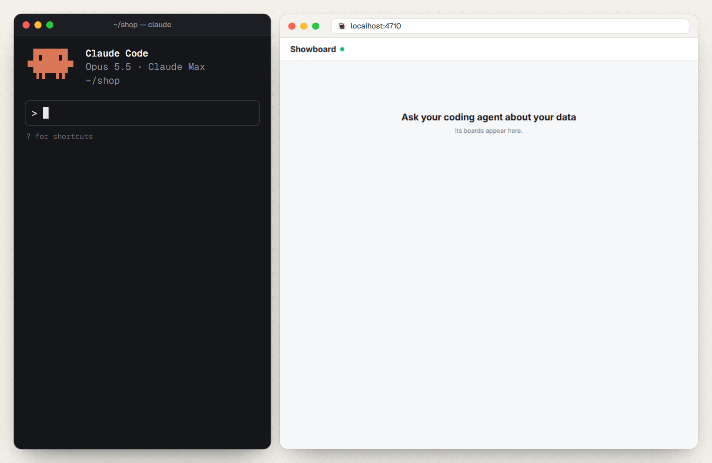
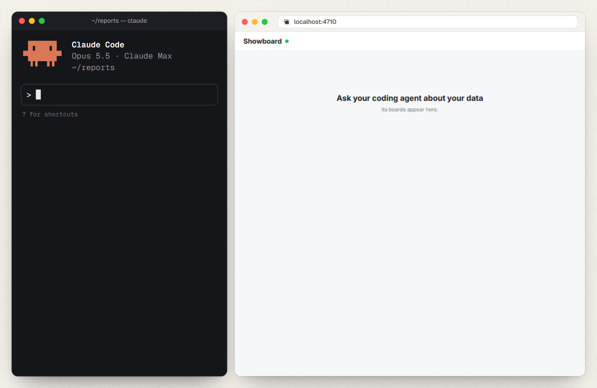
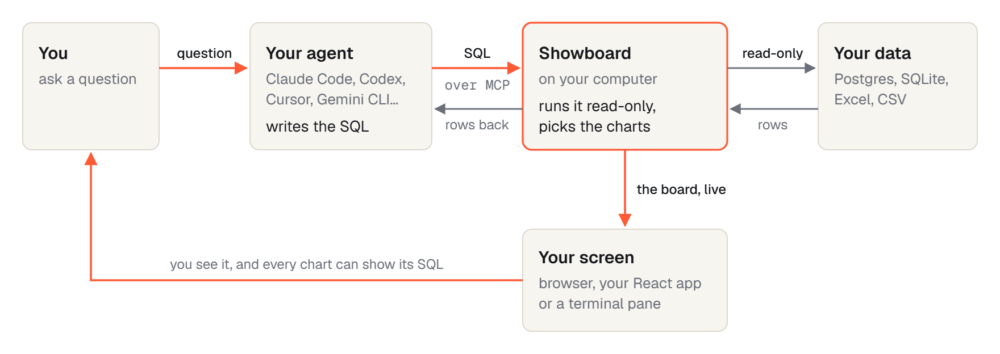
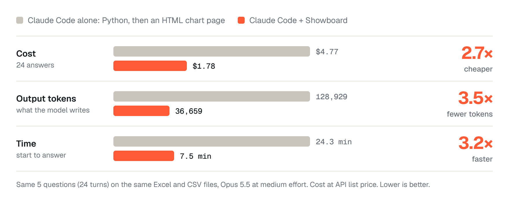

<div align="center">


### Turn your Excel, CSV and SQL data into dashboards with Claude Code.

Ask a question. Showboard runs read-only queries and draws the charts.<br />
See the SQL behind every chart, and ask a follow-up to explore further.

**[Explore the demo](https://rohanbeingsocial.github.io/showboard/)** &nbsp;·&nbsp; **[Get started](#quick-start)** &nbsp;·&nbsp; **[Documentation](docs/README.md)**

<br />

**“Show me my best seller of 2026, and how it compares with last year.”**

<picture>
  <source media="(prefers-color-scheme: dark)" srcset="docs/images/hero-dark.gif" />
  
</picture>

**2.7× cheaper** &nbsp;·&nbsp; **3.5× fewer output tokens** &nbsp;·&nbsp; **3.2× faster**<br />
<sub>Claude Code with Showboard against Claude Code on its own, on the same questions and the same files. [See the benchmark](#benchmark)</sub>

One question becomes a dashboard of headline numbers, charts and tables,<br />
in your browser, beside your terminal or inside your app.

[](#works-with-your-agent)
[](LICENSE)
[](#quick-start)
[](https://mcpservers.org/servers/rohanbeingsocial/showboard)
[](https://glama.ai/mcp/servers/rohanbeingsocial/showboard)

<sub>Open source · MIT licensed · Runs on your computer · Also works with Codex, Cursor and other MCP-compatible agents</sub>

**[Star Showboard to follow updates.](https://github.com/rohanbeingsocial/showboard)**

</div>

## Your agent can write charts. Why add Showboard?

Without Showboard, a chart request can become a coding task: read files, calculate results, write a page and wire up charts. Showboard gives your agent a ready-made way to query the data and display the answer.

<table>
  <tr>
    <td width="33%" valign="top">
      <b>Question to dashboard</b><br />
      The agent sends SQL and a short layout. Showboard runs the queries, chooses charts and displays the board.
    </td>
    <td width="33%" valign="top">
      <b>Numbers you can check</b><br />
      Open the SQL behind a chart. Chart values come from query results, not numbers the agent types into a layout.
    </td>
    <td width="33%" valign="top">
      <b>Answers you can reuse</b><br />
      Saved recipes redraw a board for new inputs. Saved boards keep a snapshot you can reopen.
    </td>
  </tr>
</table>

## Quick start

You need **Node.js 22.13+** and a coding agent. Start with a folder of Excel or CSV files, a SQLite database, or a Postgres connection.

**1. In Claude Code, install the plugin:**

```text
/plugin install showboard --marketplace rohanbeingsocial/showboard
```

Choose your data folder or database when prompted. [Plugin instructions](plugins/claude-code).

**2. Ask about your data:**

> Which products brought in the most revenue, and how did that change month by month?

**3. See the board** in a pane beside the chat (type `/board` to open it) and at http://localhost:4711.

<details>
<summary><b>Using Codex, Cursor or another agent?</b></summary>

<br />

In your project, paste this into your agent:

```text
Set up Showboard in this project: run npx showboard guide and follow it.
```

The guide walks your agent through setup and checks the connection with `showboard doctor`. Boards open at http://localhost:4710, or run `npx showboard pane` in a terminal beside your agent.

</details>

<details>
<summary><b>Prefer to set it up yourself?</b></summary>

<br />

For a folder of spreadsheets:

```bash
cd my-reports
npx showboard init .
```

For a database:

```bash
npx showboard init --db ./shop.sqlite
```

Restart your agent in that folder and open http://localhost:4710. Claude Code is the default; add `--agent codex,cursor,gemini` to configure other agents.

For Postgres credentials, use the `SHOWBOARD_DB` environment variable instead of putting a password in settings files. See the [setup guide](SETUP.md).

</details>

<details>
<summary><b>Install the Claude desktop extension</b></summary>

<br />

For the Claude desktop app, download the `.mcpb` extension from the [latest release](https://github.com/rohanbeingsocial/showboard/releases/latest). Install it through **Settings → Extensions → Advanced settings → Install Extension**. This path does not require a separate Node.js installation. [Desktop instructions](plugins/claude-desktop).

</details>

**Just looking? [Explore the browser demo](https://rohanbeingsocial.github.io/showboard/) before installing.**

## Start with the data you already have

| Your data | What you can ask |
| --- | --- |
| A folder of Excel and CSV reports | “Which regions are behind target?” Join orders in a workbook with targets in a CSV. |
| A SQLite or Postgres database | “Show monthly revenue and the top five products.” Query your tables read-only. |
| Your own Node + React app | Put boards inside your app and expose the data sources and actions your agent can use. [Integration guide](docs/integration.md) · [API reference](docs/reference.md) |

Spreadsheet loading handles title rows, blank rows, total rows, currency strings and common date formats. Each sheet becomes a queryable table; files reload when you save them.

<details>
<summary><b>See a dashboard built from Excel and CSV</b></summary>

<br />

<div align="center">

<picture>
  <source media="(prefers-color-scheme: dark)" srcset="docs/images/spreadsheets-dark.gif" />
  
</picture>

<sub>Orders in Excel. Targets in CSV. One question shows the regional gaps and the queries behind them.</sub>

</div>

</details>

## In a real app

It works on real data too. Meridian, a private investing app, has Showboard inside. Here Claude Code is asked whether silver rose each time the gold/silver ratio crossed above 90. It reads two years of MCX gold and silver prices from the app's own API and draws one board.

<div align="center">

<picture>
  <source media="(prefers-color-scheme: dark)" srcset="docs/images/meridian-dark.gif" />
  
</picture>

<sub>The ratio and silver side by side, each stretch above 90 marked in orange, and silver's moves 1, 3 and 6 months after each cross.</sub>

</div>

## How it works

<picture>
  <source media="(prefers-color-scheme: dark)" srcset="docs/images/architecture-dark.png" />
  
</picture>

<p align="center">
  <a href="docs/architecture.md">Explore the architecture</a> &nbsp;·&nbsp; <a href="docs/examples.md">See real app and spreadsheet examples</a>
</p>

## Benchmark

<p align="center">
  <picture>
    <source media="(prefers-color-scheme: dark)" srcset="docs/images/benchmark-dark.png" />
    
  </picture>
</p>

Across 24 answers each way in our Claude Code test, API-priced cost was **$1.78 with Showboard vs $4.77 without**, and elapsed time was **7.5 vs 24.3 minutes**.

This was two runs on one dataset. Other agents have not been benchmarked, and Claude's hand-built pages were more individually designed. These results are evidence for this workload, not a guarantee for yours.

<p align="center">
  <a href="docs/evaluation.md#benchmark">Read the comparison and tradeoffs</a> &nbsp;·&nbsp; <a href="bench/README.md">Reproduce the benchmark</a>
</p>

## Works with your agent

Showboard is an **MCP server**. It uses the coding agent and model access you already have.

`showboard init --agent` can configure Claude Code, Codex, Cursor, Gemini CLI, OpenCode, VS Code, Windsurf, Antigravity and BharatCode.

**Claude Code is tested end to end.** Setup support for other agents does not mean they have all received the same testing. [Agent configuration and testing status](docs/getting-started.md#works-with-your-agent).

## A few things to know

<table>
  <tr>
    <td width="30%" valign="top"><b>Does my data leave my computer?</b></td>
    <td>Showboard runs locally, but query results go back to your agent and its model provider. Use the same judgment you would when giving that agent access to your files.</td>
  </tr>
  <tr>
    <td valign="top"><b>Can it change my data?</b></td>
    <td>Database queries are read-only, and spreadsheet files are only read. Inside your app, the agent can run actions you explicitly register. Use a read-only database role as well.</td>
  </tr>
  <tr>
    <td valign="top"><b>Do I need another model API key?</b></td>
    <td>No additional key is needed for use with your coding agent. A customer-facing integration needs its own model access.</td>
  </tr>
  <tr>
    <td valign="top"><b>Are the answers always right?</b></td>
    <td>Charts use query results, but the agent can still choose the wrong query or draw the wrong conclusion. Inspect the SQL. Boards are snapshots; ask again or run a recipe for fresh data. Queries retain at most 5,000 rows.</td>
  </tr>
</table>

## Considering using Showboard?

The documentation covers the details needed to decide whether it fits your workflow:

- **[Evaluate the fit](docs/evaluation.md):** capabilities, benchmark methodology, read-only guarantees, limitations and roadmap.
- **[Set up your agent](docs/getting-started.md):** installation paths, compatibility, the runnable demo and terminal controls.
- **[Integrate it into your app](docs/integration.md):** server and React setup, recipes, custom components, actions and data sources.
- **[Look up the API](docs/reference.md):** options, props, tools, commands and defaults.

## Help shape Showboard

Showboard is young, MIT licensed and built with AI assistance, mostly Claude Code. It has a test suite and a reproducible benchmark; real-world feedback is welcome.

[Report a problem](https://github.com/rohanbeingsocial/showboard/issues) · [Contribute](CONTRIBUTING.md) · [Read the docs](docs/README.md) · [MIT license](LICENSE)

<br />

<div align="center">

**[Star Showboard to follow updates.](https://github.com/rohanbeingsocial/showboard)**

</div>
