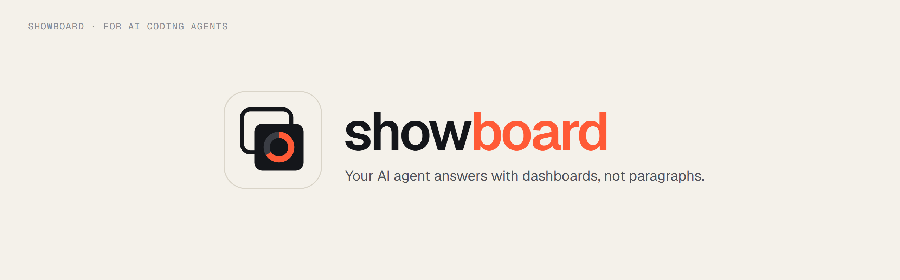

<div align="center">



## Give your coding agent a pen for your app.

It **draws** answers from your data, **shows** them where you work, and **does** what your app allows: opens a page, sets a filter, presses a button. It works with Claude Code, Codex, OpenCode, Gemini CLI and other coding agents.

Draw from Your Data • Show It in Your App • Do Your App's Actions • See What's on Screen

### Your agent can tell you. Now it can show you, and take you there.

Your database computes every number, from read-only SQL or straight from Excel and CSV files. Showboard picks the charts, lays out the board and puts it on your page, or in a pane beside the terminal. It runs on the coding agent you already use, with no extra API key.

> *Ask in the terminal. Your agent draws the answer on your screen, then takes you where it points.*

[](./LICENSE)


</div>

> [!NOTE]
> **Showboard is early.** It works, it is tested (a Vitest suite in `packages/showboard/test`) and it is documented, but it is not on npm yet. Until it is, build it from source ([Installation](#installation)) and run `node packages/showboard/dist/cli/main.js` wherever this page says `npx showboard`.

<p align="center">
  
  <br />
  <em>A board arriving in the demo shop's admin page, then its button running the shop's own Orders filter</em>
</p>

<p align="center">
  
  <br />
  <em>Excel and CSV, no app needed: rupee amounts in lakh and crore, and the SQL behind every chart</em>
</p>

<p align="center">
  <strong><a href="#quick-start">▶ Try the demo</a></strong>
  — a furniture shop's admin app, running in two commands
</p>

---

## Overview

Coding agents are good at working out answers from your data, but in a terminal they can only tell you. Showboard gives yours a pen for your app:

- **Draw.** It composes **boards** of charts, tables, headline numbers and notes from read-only SQL on your database, your spreadsheets, or rows your app computes, and can use your own React components beside the built-in ones.
- **Show.** The board appears on a page of your app, on Showboard's own page, or as text in a pane beside the terminal.
- **Do.** It runs the actions your app hands it, such as opening a page, setting a filter or selecting a row, and a board can carry buttons that run them.
- **See.** It reads what the page publishes, such as which page is open and which filters are set, so it knows what you are looking at.

The pen has two limits, on purpose. It draws only in the space your app gives it, and it acts only through the actions your app registers, never by clicking around your screen. It also never types a figure: the agent writes read-only SQL, and Showboard runs it, picks a chart for each result, lays out the board and checks it. Every part can show the query it came from.

1. You ask your agent something, like *"Which regions are behind their 2026 targets?"*
2. The agent calls a Showboard tool over MCP: a ready-made recipe, or `draw` with one SQL query per chart.
3. Showboard runs the queries read-only, picks the charts from the shape of each result and lays out the board.
4. The board appears on the page (and in any pane watching) and joins the saved boards. The agent gets the rows back, so it can check what it tells you.

## Features

- **Read-only by design** — Postgres queries run in a `READ ONLY` transaction with a time and row limit; SQLite files and spreadsheets are opened read-only.
- **Charts picked from the data** — dates become lines, labels become bars, a single row becomes headline numbers, anything else a table. The agent can still choose every chart itself.
- **One call per board** — `draw` fetches and lays out a whole board, with notes, side-by-side rows and titled sections, in a single tool call.
- **Recipes** — a board worth repeating becomes a one-call recipe with parameters. Your app ships its own, and the agent saves new ones.
- **Your app, your components** — boards can use your own React components and run your app's actions, and the agent can see what is on screen.
- **Excel and CSV** — a folder of spreadsheets becomes tables the agent can join, untidy title rows, "Total" rows and `₹1,23,456` typed as text included.
- **Show sources** — every chart, table and number can show the query behind it.
- **Any coding agent** — Claude Code, Codex, OpenCode, Gemini CLI, Cursor, VS Code, Antigravity and Windsurf: `showboard init --agent` writes each one's settings.
- **A pane beside the terminal** — `showboard pane` draws each board as text in a terminal split, with no browser; Claude Code gets the same pane beside its chat.
- **A cheaper model for new boards** — in Claude Code, a `board-builder` agent on Sonnet builds new kinds of board in its own small context.
- **No extra API key** — it runs on the agent you already use.

## Installation

```bash
npm install showboard zod
# Postgres (optional):
npm install pg
```

The React parts need React 19, and everything needs Node.js 22.13 or later (Showboard uses the built-in `node:sqlite`). Your agent's own login covers your own and internal dashboards; putting Showboard in front of your customers needs a model API key instead.

**Before it is on npm**, build it from this repository:

```bash
git clone https://github.com/rohanbeingsocial/showboard.git
cd showboard
npm install
npm run build
```

Then run the CLI as `node <this repo>/packages/showboard/dist/cli/main.js`. For your app, run `npm pack` in `packages/showboard` and `npm install <path>/showboard-0.2.0.tgz zod` in the app. Run from the built repository, `showboard init` writes settings that start it with `node`; run `init` again from an npm install once Showboard is published, to switch them to `npx`.

## Quick Start

### Let your agent set it up

In your project, ask your coding agent:

> *Set up Showboard in this project: run `npx showboard guide` and follow it.*

Until Showboard is on npm, point the agent at a built checkout instead: *"…follow SETUP.md in `<this repo>`."* The guide ([SETUP.md](SETUP.md)) has the agent pick the path that fits the project: spreadsheets, a database, or your own app (with server code for Next.js, Express, Hono and `node:http`). The agent then checks its own work with `showboard doctor`, which starts Showboard the way each agent will and says how to fix anything that fails.

### Try the demo

A small furniture shop's admin app, with its data in SQLite:

```bash
npm install
npm run demo        # builds, seeds the shop's database and serves http://localhost:4710
```

Open http://localhost:4710, then start Claude Code in the demo's folder from a second terminal:

```bash
cd examples/sales-demo
claude              # the .mcp.json here connects Claude Code to the demo
```

Allow the folder's MCP server when Claude Code asks, then ask *"Show me my best-selling product of 2026, and how it compares with last year."* *"Top 5 products of 2025"* uses one of the demo's recipes, so that board takes a single tool call.

### Your spreadsheets

```bash
cd my-reports       # a folder of .xlsx, .xlsm, .csv or .tsv files
npx showboard init .   # Claude Code; --agent codex,opencode,gemini… for others
claude                 # then open http://localhost:4710, or run: npx showboard pane
```

Each sheet becomes a table the agent can query and join. Loading copes with the usual mess: title rows above the header, blank rows, "Total" rows (skipped so sums do not double count), `N/A` in number columns, `₹1,23,456` and `$1,234.50` typed as text, Excel dates, and `15-Mar-2026` or `25/04/2026` text dates. Amounts print in the files' own currency, ₹ in lakh and crore for rupee sheets. The files are only read, and they reload when you save them. The sample files in `examples/spreadsheets` show it: `cd examples/spreadsheets`, run `claude` and open http://localhost:4720.

### A database, no app

```bash
npx showboard init --db ./shop.sqlite      # or a Postgres URL; SHOWBOARD_DB keeps a password out of the settings
claude                                     # boards appear at http://localhost:4710
```

### Your app

**Server.** The handler takes a fetch `Request` and returns a `Response`, so any Node server can mount it.

```ts
import { createShowboard } from "showboard/server";

const showboard = await createShowboard({
  db: process.env.DATABASE_URL,      // a Postgres URL, a SQLite file, or { pool } with your own pg Pool
  boardsDir: ".showboard/boards",    // keep boards across restarts
});
const handle = showboard.handler({ basePath: "/showboard" });

app.all("/showboard/*", (c) => handle(c.req.raw));            // Hono
// node:http and Express: toNodeListener(handle) from "showboard/server"
```

**Browser.**

```tsx
import { Board, BoardList, ShowboardProvider } from "showboard/react";
import "showboard/styles.css";

<ShowboardProvider url="/showboard" onBoard={() => navigate("/board")}>
  <App />
</ShowboardProvider>;

// On the page that holds the agent's answers:
<Board />        {/* the board shown last */}
<BoardList />    {/* saved boards; click one to open it */}
```

**Your agent.** In your project folder, then start your app and your agent:

```bash
npx showboard init --url http://localhost:3000/showboard --agent claude,codex
```

## Works With Your Agent

Showboard is an MCP server, so any coding agent that speaks MCP can use it. `showboard init --agent <names>` writes the settings for each one you name (comma separated, or `all`); with no `--agent`, it sets up Claude Code plus any agent the folder already has settings for.

| Agent | `init` writes | Notes |
| --- | --- | --- |
| Claude Code | `.mcp.json` | Approve the server when Claude Code first asks. Also gets the `board-builder` agent. |
| Codex | `.codex/config.toml` | Codex reads it only in a trusted project. |
| OpenCode | `opencode.json` | `opencode mcp list` shows it connected. |
| Gemini CLI | `.gemini/settings.json` | Trust the folder when Gemini CLI asks; `gemini mcp list` shows it connected. |
| Cursor | `.cursor/mcp.json` | Names the project folder with `--root`, since Cursor starts servers elsewhere. |
| VS Code | `.vscode/mcp.json` | Uses `${workspaceFolder}`; start it under MCP Servers, then use agent mode. |
| Antigravity | `~/.gemini/config/mcp_config.json` | User-wide, so the entry names the project folder. Named only on purpose: not part of `all`. |
| Windsurf | `~/.codeium/windsurf/mcp_config.json` | User-wide, like Antigravity. |

Boards have been drawn end to end in Claude Code. For the other agents, the settings `init` writes have been checked to load and connect, and the server answers their MCP requests; a live session in each is still to come.

## The Pane

No browser needed: `showboard pane` draws the board on screen as text, in a terminal split beside your agent, and follows each new board as the agent draws it.

<p align="center">
  
  <br />
  <em>The demo shop's 2025 board in a terminal pane: every figure from the board's own rows</em>
</p>

```bash
npx showboard pane                                     # Showboard on port 4710
npx showboard pane --url http://localhost:3000/showboard   # one your app mounts
```

Lines become braille, bars become blocks, shares become one stacked bar with a legend, and tables, notes and headline numbers print as they are, every figure read from the board's data. Keys: <kbd>←</kbd> <kbd>→</kbd> older and newer boards, <kbd>s</kbd> sources, <kbd>1</kbd>–<kbd>9</kbd> the board's buttons (they run in your app), <kbd>o</kbd> the browser, <kbd>q</kbd> quit. `--once` prints the board and exits.

In Claude Code, the same view sits beside the chat as a mod: [plugins/claude-code](plugins/claude-code). It opens by itself when a board arrives and the terminal has room, and `/board` opens it anywhere. Install it at the prompt of a Claude Code terminal session:

```text
/plugin install showboard --marketplace rohanbeingsocial/showboard
```

## Examples

**A whole board in one call.** What the agent sends to `draw`. Each part brings its own SQL; the first part becomes a line per channel, the second asks for a pie:

```json
{
  "title": "Orders by channel, {year}",
  "params": { "year": "2026" },
  "items": [
    { "note": "Paid orders only.", "tone": "info" },
    { "row": [
      { "title": "By month",
        "sql": "SELECT substr(ordered_at, 1, 7) AS month, channel, count(*) AS orders FROM orders WHERE status = 'paid' AND substr(ordered_at, 1, 4) = :year GROUP BY 1, 2" },
      { "title": "Share", "show": "pie",
        "sql": "SELECT channel, count(*) AS orders FROM orders WHERE status = 'paid' AND substr(ordered_at, 1, 4) = :year GROUP BY 1" }
    ] }
  ],
  "save_as": { "name": "channel_orders", "about": "Paid orders by channel for one year." }
}
```

**The same board for another year** is now one `recipe` call of a few hundred tokens:

```json
{ "name": "channel_orders", "params": { "year": "2025" } }
```

**Recipes your app ships.** `:year` and `:limit` become real query parameters, never text pasted into the SQL:

```ts
createShowboard({
  db,
  recipes: [{
    name: "top_products",
    about: "A year's best-selling products by paid revenue.",
    title: "Top products of {year}",
    params: { year: { default: "2026" }, limit: { default: 10 } },
    items: [{
      title: "Revenue by product",
      sql: `SELECT p.name AS product, round(sum(i.qty * i.unit_price), 2) AS revenue
            FROM order_items i JOIN orders o ON o.id = i.order_id JOIN products p ON p.id = i.product_id
            WHERE o.status = 'paid' AND substr(o.ordered_at, 1, 4) = :year
            GROUP BY p.name ORDER BY revenue DESC LIMIT :limit`,
      formats: { revenue: "currency" },
    }],
  }],
});
```

**Your own components** next to the built-in ones:

```tsx
import { z } from "zod";
import type { ShowboardComponent } from "showboard/react";

const props = z.object({ sku: z.string().describe("Product SKU, e.g. DSK-AERO") });

export const ProductCard: ShowboardComponent<typeof props> = {
  description: "The shop's product card: name, price and units sold this year.",
  props,
  render: ({ props }) => <ProductTile sku={props.sku} />,   // a component you already have
};

const COMPONENTS = { ProductCard };   // a module constant: a new object redraws every board
<ShowboardProvider url="/showboard" components={COMPONENTS}>…</ShowboardProvider>;
```

**Actions the agent can run, and state it can see:**

```tsx
import { useShowboardAction, useShowboardState } from "showboard/react";

const filterOrdersInput = z.object({ month: z.string().describe("YYYY-MM") });   // outside the component

function ClaudeHooks({ page, setPage, setFilters }) {
  useShowboardState("page", page);   // the agent reads it with get_screen
  useShowboardAction({
    name: "filter_orders",
    description: "Open the Orders page for one month.",
    input: filterOrdersInput,
    run: ({ month }) => {
      setFilters({ month });
      setPage("orders");
    },
  });
  return null;
}
```

The agent runs an action with `ui_act`, and a board can carry an `ActionButton` that runs one, like the button in the demo GIF above.

**Rows your server computes**, offered to the agent by name:

```ts
createShowboard({
  db,
  sources: [{
    name: "stock_levels",
    description: "Units in stock per product, from the warehouse system.",
    input: z.object({ category: z.string().optional() }),
    run: ({ category }) => warehouse.stockLevels(category),   // an array of plain objects
  }],
});
```

## Tools Your Agent Gets

| Tool | What it does |
| --- | --- |
| `describe_data` | Lists the tables and columns, the app's sources and the recipes |
| `recipe` | Draws a ready-made board for new values, in one call |
| `draw` | Fetches and draws a whole board in one call |
| `query_data` | Runs one read-only SELECT and keeps the rows as a named dataset (with a database) |
| `use_source` | Gets rows your server computes (when your app has sources) |
| `show_board` | The long form: a [json-render](https://github.com/vercel-labs/json-render) layout the agent writes element by element; also reopens a saved board |
| `list_boards` | Lists the saved boards |
| `get_screen` | What the browser shows: the page's state, its actions and its components |
| `ui_act` | Runs one of the page's actions |

Showboard tells the agent to reach for a recipe first, then `draw`. New recipes reach the agent without a restart where it listens for tool-list changes, as Claude Code does; `describe_data` lists them for the rest.

## API Overview

| Export | Kind | Purpose |
| --- | --- | --- |
| `createShowboard` | fn | Opens your database or files; returns the tools and the HTTP handler. |
| `toNodeListener`, `serve` | fn | Mount the handler on `node:http` or Express, or serve it on its own. |
| `ShowboardProvider` *(/react)* | component | Connects the page to the handler and holds the board on screen. |
| `Board`, `BoardList` *(/react)* | component | The board shown last, and the saved boards. |
| `useShowboardAction`, `useShowboardState` *(/react)* | hook | Actions the agent can run, and state it can see. |
| `formatValue` *(/react)* | fn | Prints numbers the way boards do, for your own components. |
| `boardToText` *(/text)* | fn | A board as lines of styled text, for a pane of your own. |
| `showboard serve \| mcp \| init \| pane` | CLI | Showboard's own board page, the MCP server, setup for each agent, and the terminal pane. |
| `showboard guide \| doctor` | CLI | Setup steps written for coding agents, and a check of the setup as each agent will meet it. |

Full reference, with every option, prop, tool, flag and the chart-picking rules: [docs/reference.md](docs/reference.md).

## Safety

Your agent can read your data. It cannot change it, and in your app it can do only what you let it.

- **Postgres** — each query runs in a `READ ONLY` transaction as a single statement, with a time limit (5 s) and a row limit (5,000).
- **SQLite** — the file is opened read-only, with the same row limit.
- **Spreadsheets** — loaded into an in-memory copy that refuses writes. Your files are only read.
- **SQL** — only `SELECT` (and `WITH … SELECT`, `VALUES`, `TABLE`) is accepted.
- **Actions** — the agent can run only the actions your app registers with `useShowboardAction`, each with an input your schema checks; it cannot click or type anywhere else.
- **HTTP** — the handler answers only `localhost` and `127.0.0.1`, and refuses requests from other sites' pages, so a website open in your browser cannot run the tools.

Use a read-only database role anyway.

## What It Does Not Guarantee

- **Notes are the agent's own words.** Charts, tables and headline numbers read their values from query results. A note is text the agent writes: it is told to quote only figures it has read, but its conclusions can still be wrong. In testing, Claude once named the wrong product as the units leader, because it had only queried the top 10 by revenue. Tick *Show sources* to check.
- **The pane draws charts as text.** Its braille lines and block bars carry the same figures, at a terminal's resolution; the board page has the full charts.
- **A board is a snapshot.** It keeps the rows it was drawn from, so opening it next week shows the numbers as they were then. Ask again, or run its recipe, for fresh ones.
- **Big results are cut.** A query keeps at most 5,000 rows, and a chart draws at most 6 lines, or 4 bars per label. The agent is told what was left out, so it can aggregate or filter in SQL.

## Cost

Most of what a board costs is steps, because each step re-reads the whole conversation; that is why a board is one call. Measured in Claude Code with Opus 5.5 at medium effort, on five questions about a set of spreadsheets, each asked four times: compared with Claude writing the analysis as code and the charts as an HTML page, Showboard cost **2.7× less**, used **3.5× fewer output tokens** and answered **3.2× faster**, with the same figures.

On the demo shop, at API list prices, *"Top 5 products of 2025"* was one `recipe` call ($0.26), and *"Each channel's revenue by quarter, 2025 vs 2026"* one `draw` call ($0.37) that saved itself as a recipe. The benchmark and how to rerun it on your own files: [bench/](bench/README.md). Other agents have not been measured yet.

## Roadmap

- [x] A pane beside the terminal: `showboard pane` for any agent, and a Claude Code mod
- [x] Settings for Codex, OpenCode, Gemini CLI, Cursor, VS Code, Antigravity and Windsurf
- [ ] Publish to npm
- [ ] A leaner launch that trims Claude Code's fixed prompt, the biggest share of what a board costs
- [ ] A `board-builder` agent for the agents besides Claude Code that have subagents

## Development

```bash
npm install
npm run build        # the package, its board page and the Claude Code mod's renderer
npm test             # SHOWBOARD_TEST_PG=<postgres url> also runs the Postgres tests
npm run test:pane    # the Claude Code mod, in Claude Code's own plugin test kit
npm run typecheck
npm run demo
```

| Folder | What is in it |
| --- | --- |
| `packages/showboard/src/server` | `createShowboard`, the tools, read-only database access, spreadsheet loading, the HTTP handler |
| `packages/showboard/src/react` | `ShowboardProvider`, `Board`, the built-in components and the hooks |
| `packages/showboard/src/spec` | The component catalog, number formats and board checks |
| `packages/showboard/src/text` | Boards drawn as text, for the panes |
| `packages/showboard/src/cli` | The `serve`, `mcp`, `init` and `pane` commands, and each agent's settings |
| `packages/showboard/src/viewer` | Showboard's own board page |
| `plugins/claude-code` | The Claude Code mod: the pane beside the chat, listed for `/plugin install` in `.claude-plugin/marketplace.json` |
| `examples/` | The demo shop and the sample spreadsheets |
| `bench/` | The cost benchmark |

## License

MIT — see [LICENSE](./LICENSE).
