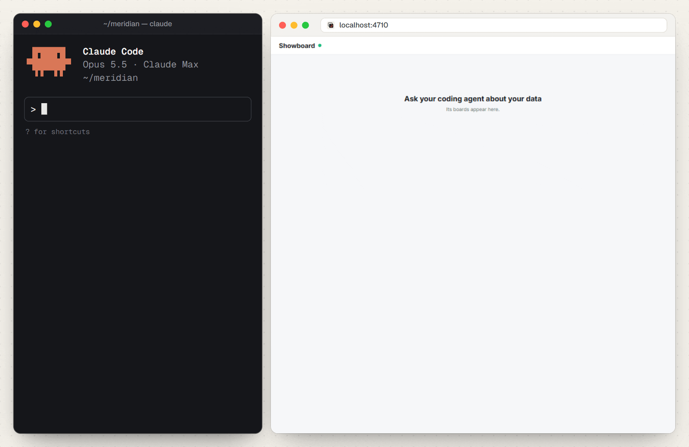

<div align="center">


### 用 Claude Code 把你的 Excel、CSV 和 SQL 数据变成仪表盘。

提出一个问题，Showboard 运行只读查询并画出图表。<br />
每张图表背后的 SQL 都能查看，还可以继续追问、深入探索。

**[查看在线演示](https://rohanbeingsocial.github.io/showboard/)** &nbsp;·&nbsp; **[快速开始](#快速开始)** &nbsp;·&nbsp; **[文档（英文）](docs/README.md)**

[English](README.md) &nbsp;·&nbsp; **简体中文**

<br />

**“告诉我 2026 年最畅销的产品，以及和去年相比怎么样。”**

<picture>
  <source media="(prefers-color-scheme: dark)" srcset="docs/images/hero-dark.gif" />
  
</picture>

**成本低 2.7 倍** &nbsp;·&nbsp; **输出 token 少 3.5 倍** &nbsp;·&nbsp; **速度快 3.2 倍**<br />
<sub>同样的问题、同样的文件，Claude Code 配合 Showboard 对比 Claude Code 单独完成。[查看基准测试](#基准测试)</sub>

一个问题，得到一整块仪表盘：关键数字、图表和表格，<br />
显示在浏览器里、终端旁边，或者你自己的应用中。

[](#支持的智能体)
[](LICENSE)
[](#快速开始)
[](https://mcpservers.org/servers/rohanbeingsocial/showboard)
[](https://glama.ai/mcp/servers/rohanbeingsocial/showboard)

<sub>开源 · MIT 许可 · 在你自己的电脑上运行 · 也支持 Codex、Cursor 和其他兼容 MCP 的智能体</sub>

**[给 Showboard 点个 Star，关注后续更新。](https://github.com/rohanbeingsocial/showboard)**

</div>

## 智能体自己也能画图，为什么还要 Showboard？

没有 Showboard 时，一个画图请求往往会变成一项编程任务：读文件、算结果、写网页、接上图表。Showboard 给智能体一条现成的路：查询数据，然后把答案展示出来。

<table>
  <tr>
    <td width="33%" valign="top">
      <b>从问题到仪表盘</b><br />
      智能体发送 SQL 和一个简短的布局。Showboard 运行查询、选择图表并展示整块仪表盘。
    </td>
    <td width="33%" valign="top">
      <b>数字可以核对</b><br />
      打开任意图表背后的 SQL。图表中的数值来自查询结果，而不是智能体手动填进布局的数字。
    </td>
    <td width="33%" valign="top">
      <b>答案可以复用</b><br />
      保存的配方（recipe）可以用新的输入重画仪表盘；保存的仪表盘会留下快照，随时重新打开。
    </td>
  </tr>
</table>

## 快速开始

你需要 **Node.js 22.13+** 和一个编程智能体。可以从一个 Excel 或 CSV 文件夹、一个 SQLite 数据库或一个 Postgres 连接开始。

**1. 在 Claude Code 中安装插件：**

```text
/plugin install showboard --marketplace rohanbeingsocial/showboard
```

按提示选择你的数据文件夹或数据库。[插件说明](plugins/claude-code)。

**2. 询问你的数据：**

> 哪些产品带来的收入最多？每个月的变化如何？

**3. 查看仪表盘**：在聊天旁边的窗格中（输入 `/board` 打开），以及 http://localhost:4711。

<details>
<summary><b>使用 Codex、Cursor 或其他智能体？</b></summary>

<br />

在你的项目里，把下面这句话粘贴给智能体：

```text
Set up Showboard in this project: run npx showboard guide and follow it.
```

这份指南会带着智能体完成设置，并用 `showboard doctor` 检查连接。仪表盘在 http://localhost:4710 打开，或者在智能体旁边的终端运行 `npx showboard pane`。

</details>

<details>
<summary><b>想自己动手设置？</b></summary>

<br />

用于一个电子表格文件夹：

```bash
cd my-reports
npx showboard init .
```

用于一个数据库：

```bash
npx showboard init --db ./shop.sqlite
```

在该文件夹中重启智能体，然后打开 http://localhost:4710。默认配置 Claude Code；加上 `--agent codex,cursor,gemini` 可以配置其他智能体。

Postgres 的凭据请使用 `SHOWBOARD_DB` 环境变量，不要把密码写进设置文件。详见[设置指南](SETUP.md)。

</details>

<details>
<summary><b>安装 Claude 桌面扩展</b></summary>

<br />

对于 Claude 桌面应用，从[最新发布](https://github.com/rohanbeingsocial/showboard/releases/latest)下载 `.mcpb` 扩展，然后通过 **Settings → Extensions → Advanced settings → Install Extension** 安装。这种方式不需要单独安装 Node.js。[桌面版说明](plugins/claude-desktop)。

</details>

**只是想看看？安装前先[试试浏览器演示](https://rohanbeingsocial.github.io/showboard/)。**

## 从你已有的数据开始

| 你的数据 | 你可以问什么 |
| --- | --- |
| 一个装满 Excel 和 CSV 报表的文件夹 | “哪些地区没有完成目标？”把工作簿里的订单和 CSV 里的目标关联起来。 |
| 一个 SQLite 或 Postgres 数据库 | “显示每月收入和前五名产品。”以只读方式查询你的表。 |
| 你自己的 Node + React 应用 | 把仪表盘放进你的应用，并开放智能体可以使用的数据源和操作。[集成指南](docs/integration.md) · [API 参考](docs/reference.md) |

电子表格加载能处理标题行、空行、合计行、货币字符串和常见日期格式。每个工作表都会变成一张可查询的表；保存文件后会自动重新加载。

<details>
<summary><b>看一个用 Excel 和 CSV 做出的仪表盘</b></summary>

<br />

<div align="center">

<picture>
  <source media="(prefers-color-scheme: dark)" srcset="docs/images/spreadsheets-dark.gif" />
  
</picture>

<sub>订单在 Excel 里，目标在 CSV 里。一个问题就能看出各地区的差距，以及背后的查询。</sub>

</div>

</details>

## 在真实应用中

它在真实数据上同样好用。Meridian 是一个私人投资应用，内置了 Showboard。这里向 Claude Code 提问：每次金银比升破 90 时，白银是否上涨？它从应用自己的 API 读取两年的 MCX 黄金和白银价格，并画出一块仪表盘。

<div align="center">

<picture>
  <source media="(prefers-color-scheme: dark)" srcset="docs/images/meridian-dark.gif" />
  
</picture>

<sub>金银比与白银价格并排显示，每段高于 90 的区间用橙色标出，并给出每次升破后 1、3、6 个月白银的涨跌。</sub>

</div>

## 工作原理

<picture>
  <source media="(prefers-color-scheme: dark)" srcset="docs/images/architecture-dark.png" />
  
</picture>

<p align="center">
  <a href="docs/architecture.md">了解架构（英文）</a> &nbsp;·&nbsp; <a href="docs/examples.md">查看真实应用和电子表格示例（英文）</a>
</p>

## 基准测试

<p align="center">
  <picture>
    <source media="(prefers-color-scheme: dark)" srcset="docs/images/benchmark-dark.png" />
    
  </picture>
</p>

在我们的 Claude Code 测试中，每种方式各回答 24 次：按 API 价格计算，**使用 Showboard 花费 1.78 美元，不使用花费 4.77 美元**；耗时 **7.5 分钟对 24.3 分钟**。

这是在一个数据集上跑了两轮的结果。其他智能体尚未测试，而且 Claude 手工做的页面在设计上更有个性。这些结果是针对这类任务的证据，不保证适用于你的场景。

<p align="center">
  <a href="docs/evaluation.md#benchmark">阅读对比与取舍（英文）</a> &nbsp;·&nbsp; <a href="bench/README.md">复现基准测试（英文）</a>
</p>

## 与其他方案对比

<table>
  <tr>
    <td width="30%" valign="top"><b>Claude Dashboards</b></td>
    <td>Anthropic 在 Claude 付费方案中提供的仪表盘，基于 Snowflake、BigQuery 等数据仓库和已连接的应用，每张图表都显示 SQL。Showboard 面向你已经有的文件和数据库：不需要连接器或数据仓库的杂乱 Excel 和 CSV 文件，以及 Postgres 和 SQLite。仪表盘显示在浏览器、终端窗格或你自己的应用中，并且免费、采用 MIT 许可。</td>
  </tr>
  <tr>
    <td valign="top"><b>dbt Charts</b></td>
    <td>dbt Labs 的开源图表工具：SQL 加 YAML 布局，支持 CSV、Parquet、DuckDB 和数据仓库。Showboard 直接读取 Excel 工作簿，智能体一次调用就能排好整块仪表盘。</td>
  </tr>
  <tr>
    <td valign="top"><b>只用智能体本身</b></td>
    <td>它可以为每张图表写一个脚本和一个页面，而且这些页面往往更好看。在我们的测试中，这样做成本是 2.7 倍、耗时是 3.2 倍，而且数字藏在你得自己去读的代码里。</td>
  </tr>
</table>

## 支持的智能体

Showboard 是一个 **MCP 服务器**，使用你已有的编程智能体和模型访问权限。

`showboard init --agent` 可以配置 Claude Code、Codex、Cursor、Gemini CLI、OpenCode、VS Code、Windsurf、Antigravity 和 BharatCode。

**Claude Code 已经过端到端测试。** 支持为其他智能体做设置，并不代表它们都经过了同等程度的测试。[智能体配置与测试状态（英文）](docs/getting-started.md#works-with-your-agent)。

## 需要了解的几件事

<table>
  <tr>
    <td width="30%" valign="top"><b>我的数据会离开电脑吗？</b></td>
    <td>Showboard 在本地运行，但查询结果会返回给你的智能体及其模型提供商。请像授权智能体访问你的文件时一样谨慎判断。</td>
  </tr>
  <tr>
    <td valign="top"><b>它会修改我的数据吗？</b></td>
    <td>数据库查询是只读的，电子表格文件只会被读取。在你的应用内，智能体只能运行你明确注册的操作。也建议使用只读的数据库角色。</td>
  </tr>
  <tr>
    <td valign="top"><b>需要另外的模型 API 密钥吗？</b></td>
    <td>配合编程智能体使用时不需要额外的密钥。面向客户的集成需要自己的模型访问权限。</td>
  </tr>
  <tr>
    <td valign="top"><b>答案总是对的吗？</b></td>
    <td>图表使用的是查询结果，但智能体仍可能选错查询或得出错误结论。请检查 SQL。仪表盘是快照；需要最新数据时可以重新提问或运行配方。查询最多保留 5,000 行。</td>
  </tr>
</table>

## 考虑使用 Showboard？

文档涵盖了判断它是否适合你工作流程所需的细节（目前为英文）：

- **[评估是否合适](docs/evaluation.md)：** 功能、基准测试方法、只读保证、限制和路线图。
- **[设置你的智能体](docs/getting-started.md)：** 安装方式、兼容性、可运行的演示和终端控制。
- **[集成到你的应用](docs/integration.md)：** 服务器和 React 设置、配方、自定义组件、操作和数据源。
- **[查阅 API](docs/reference.md)：** 选项、属性、工具、命令和默认值。

## 帮助改进 Showboard

Showboard 还很年轻，采用 MIT 许可，在 AI 协助下构建，主要使用 Claude Code。它有测试套件和可复现的基准测试；欢迎真实使用中的反馈。

[报告问题](https://github.com/rohanbeingsocial/showboard/issues) · [参与贡献](CONTRIBUTING.md) · [阅读文档](docs/README.md) · [MIT 许可](LICENSE)

<br />

<div align="center">

**[给 Showboard 点个 Star，关注后续更新。](https://github.com/rohanbeingsocial/showboard)**

</div>
