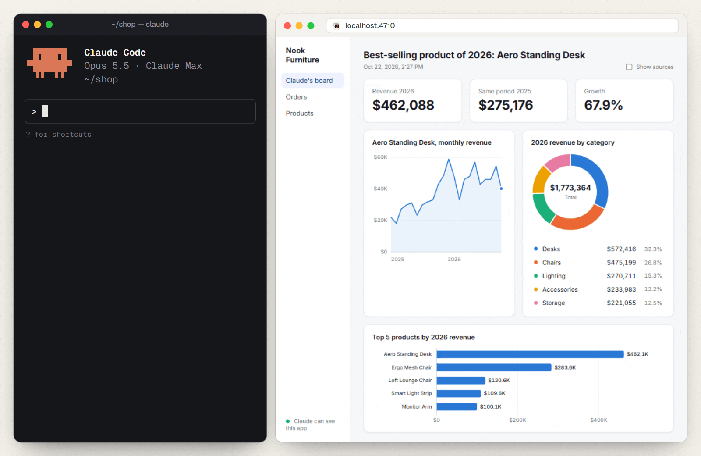

# Showboard in use

[Documentation](README.md) ? [Product overview](../README.md)

[Excel and CSV, no app needed](#excel-and-csv-no-app-needed) ? [In a real app](#in-a-real-app) ? [Inside your own app](#inside-your-own-app)

## Excel and CSV, no app needed

<picture>
  <source media="(prefers-color-scheme: dark)" srcset="../docs/images/spreadsheets-dark.gif" />
  
</picture>

A folder of spreadsheets is all it needs. Here Claude Code compares 2026 orders in an Excel workbook with targets in a CSV file, amounts in rupees, and *Show sources* opens the SQL behind a chart.

## In a real app

<picture>
  <source media="(prefers-color-scheme: dark)" srcset="../docs/images/meridian-dark.gif" />
  
</picture>

It works on real data too. Meridian, a private investing app, has Showboard inside. Here Claude Code is asked whether silver rose each time the gold/silver ratio crossed above 90. It reads two years of MCX gold and silver prices from the app's own API and draws one board: the ratio and silver side by side, each stretch above 90 marked in orange, and silver's moves 1, 3 and 6 months after each cross.

## Inside your own app

<picture>
  <source media="(prefers-color-scheme: dark)" srcset="../docs/images/demo-dark.gif" />
  
</picture>

Mount Showboard in your React app and the agent can also see what is on screen and run the actions you register. Here Claude reads the demo shop's screen with `get_screen`, then runs the shop's own `filter_orders` action, and the app opens its Orders page, filtered.

